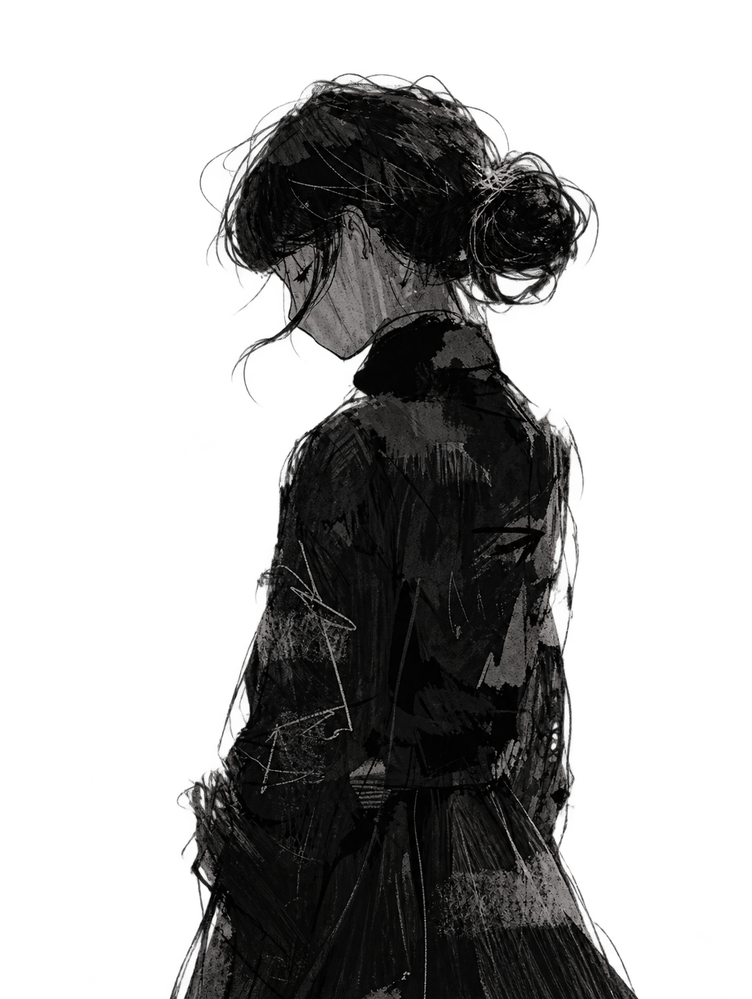

<p align="center">
    
</p>

---

<h3 align=center>✦ Welcome to my mink ✦</h3>
<p align=center>
I'm just a developer. I'm not a good developer.<br>
I only write code for fun, break things,<br>
and build stuff for myself, hoping it'll change someday.
<p>
<p align=center>⟡ <b>Age:</b> 20 ⟡ <b>English level:</b> B2 ⟡</p>

___

<h3 align=center style="margin-top: 15px">✦ Languages ✦
<br>
<div align=center>
    
    
    
    
</div>

<h3 align=center style="margin-top: 15px">✦ Related technologies ✦
<br>
<div>
    
    
    
    
    
</div>

<br>

<div align="left">

```bash
echo "Someone said open‑source is evil. I wanna be a villain then." > me.txt
```

</div>

___
